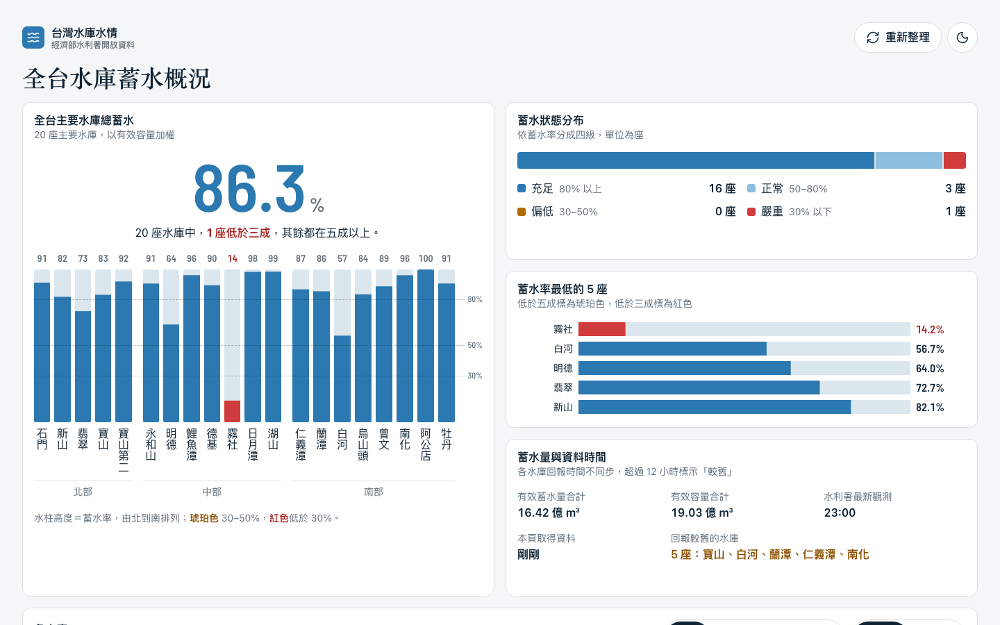
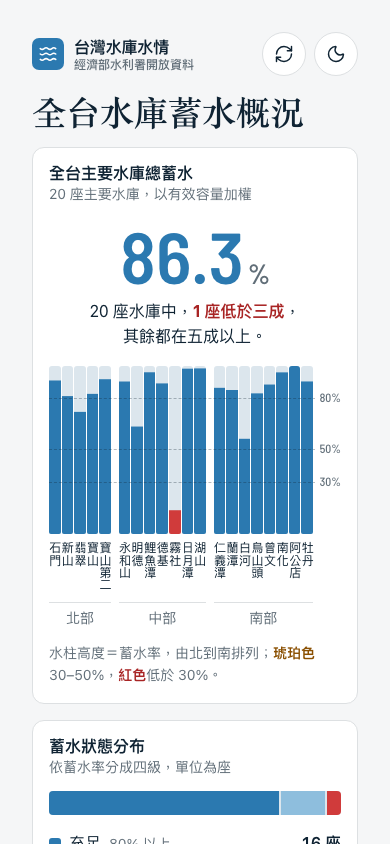
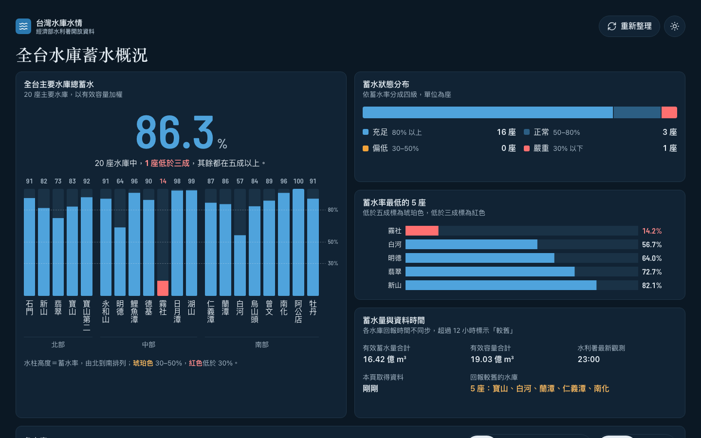
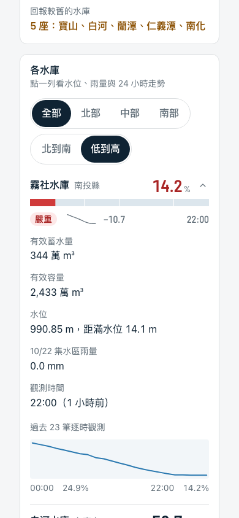
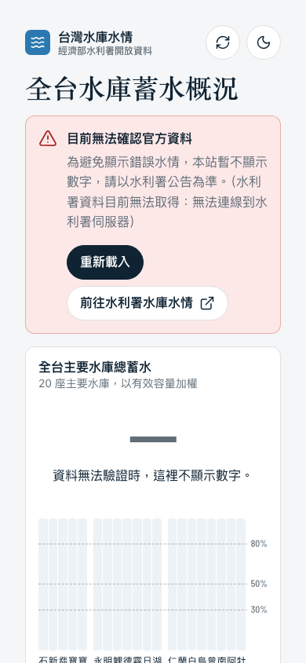
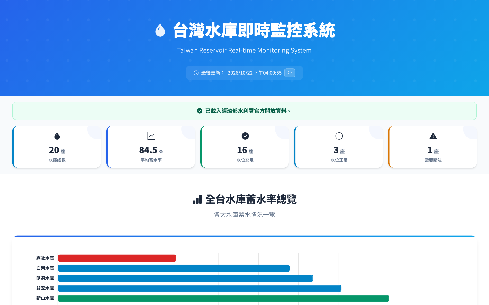
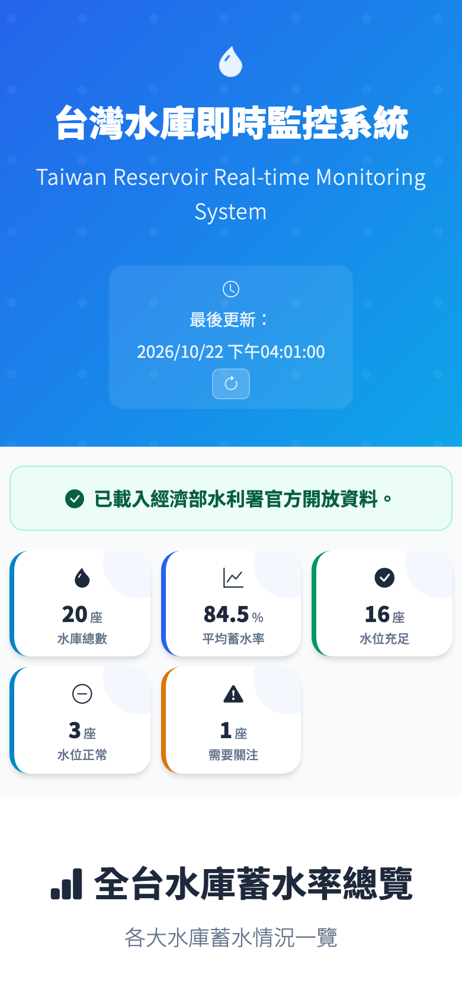

# 台灣水庫水情

全台 20 座主要水庫的即時蓄水率，一張圖看完。資料直接取自經濟部水利署開放資料；資料無法驗證時，頁面不顯示任何推測數字。

**線上版：<https://livejiaquan.github.io/taiwan-reservoir-static/>**

| 桌面 | 手機 |
|------|------|
|  |  |

## 特色

- **水尺牆**：20 座水庫由北到南排成 20 根水柱，水位高度＝蓄水率，名稱直書標註，手機上也不必橫向捲動。只有低於五成的水庫會改成琥珀色或紅色。
- **一句話總結**：「全台主要水庫總蓄水 86.6%，20 座中 1 座低於三成」，數字以容量加權計算。
- **24 小時變化**：利用水利署逐時觀測畫出迷你趨勢線，展開後可看水位、距滿水位、昨日集水區雨量與逐時走勢。
- **資料時效**：頁首顯示最新觀測時間與「幾分鐘前取得」；每座水庫各自標示觀測時間，超過 12 小時標示「較舊」。
- **不可驗證就不顯示**：API 失敗、涵蓋不足半數水庫、觀測時間無效或超過 48 小時時，整頁改為說明與重試，不留下舊數字。
- **深淺色**：預設淺色，可切換深色並記住選擇。
- 純靜態、無建置步驟、無框架，全頁約 110 KiB。Lighthouse 無障礙、最佳實務、SEO 皆為 100；效能 96–99，主要取決於水利署 API 的回應速度。

<details>
<summary>更多截圖：深色模式、清單、錯誤狀態、改版前</summary>

| 深色（桌面） | 清單依蓄水率排序並展開 | 資料無法驗證 |
|------|------|------|
|  |  |  |

| 改版前（桌面） | 改版前（手機） |
|------|------|
|  |  |

</details>

## 資料流程

```
水利署「水庫水情資料」（逐時，含過去 24 小時）─┐
                                              ├─ js/api.js：以水庫代碼合併 → 計算蓄水率 → 信任檢查 → 5 分鐘快取
水利署「水庫每日營運狀況」（有效容量、滿水位）─┘                          │
                                                                          ▼
                                    js/main.js：一句話總結、水尺牆、分區清單、側欄
```

- 蓄水率＝有效蓄水量 ÷ 有效容量，上限 100%（溢流時觀測值可能超過容量）。
- 信任檢查（`validateSnapshot`）：至少涵蓋半數對照表中的水庫、每筆觀測時間格式與日期有效、不超過 48 小時、不超前 1 小時以上。快取讀出時也會重新檢查。
- 狀態門檻：≥80% 充足、50–80% 正常、30–50% 偏低、<30% 嚴重。

## 本機開發

```bash
python3 -m http.server 8080
```

開啟 <http://localhost:8080>。測試使用 Node 內建測試執行器，不需安裝套件：

```bash
node --test tests/
```

## 專案結構

```
index.html          頁面骨架、SVG 圖示、meta／OG
css/main.css        設計 token（深淺色）與版面
js/utils.js         事件、儲存、時間與數字格式、趨勢線等純函式
js/api.js           水利署 API、資料合併與信任檢查
js/main.js          畫面狀態與繪製
assets/             品牌標記、Lucide 圖示原始檔、數字字型、favicon、OG 預覽圖
tests/              node:test 測試
docs/               使用者研究、設計研究、截圖
```

## 設計文件

- [使用者研究](docs/ux-research.md)：persona、前三項任務、非功能需求、裝置評估
- [設計研究](docs/design-research.md)：8 個同類產品比較、參考的前端設計、色彩與字體決策
- [參考頁量測](docs/references/tokens.md)：照抄版面的參考頁截圖與 token
- [圖示與品牌標記](docs/brand/icons.md)：Lucide 圖示清單與品牌標記規格

部署方式見 [DEPLOY.md](DEPLOY.md)。

## 授權

程式碼採 [MIT](LICENSE)。水庫資料來自[經濟部水利署水利資料開放平臺](https://opendata.wra.gov.tw/)，依政府資料開放授權條款使用；本站僅供參考，水情與限水措施請以水利署公告為準。
